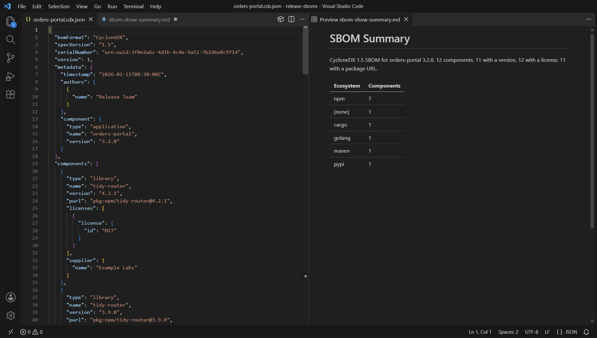
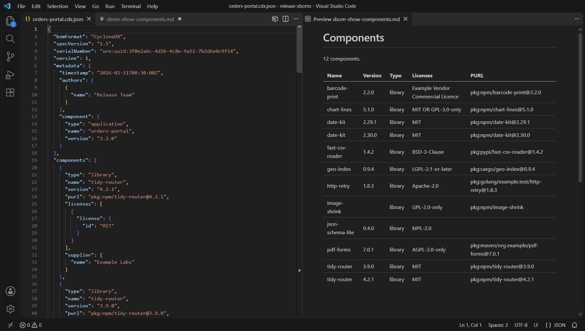
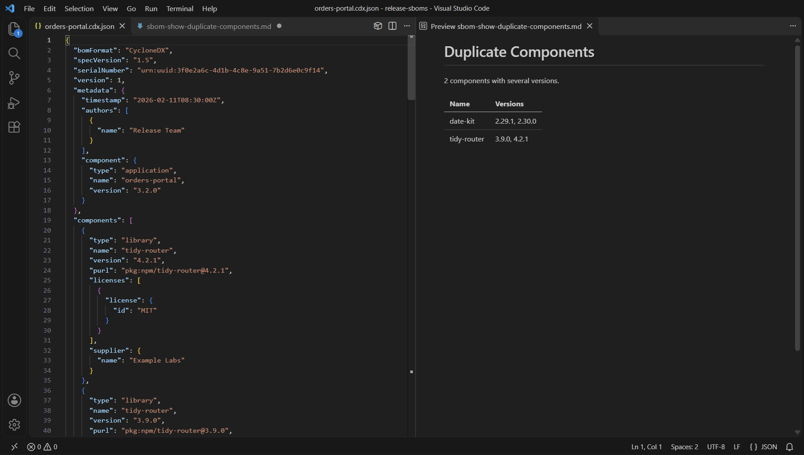
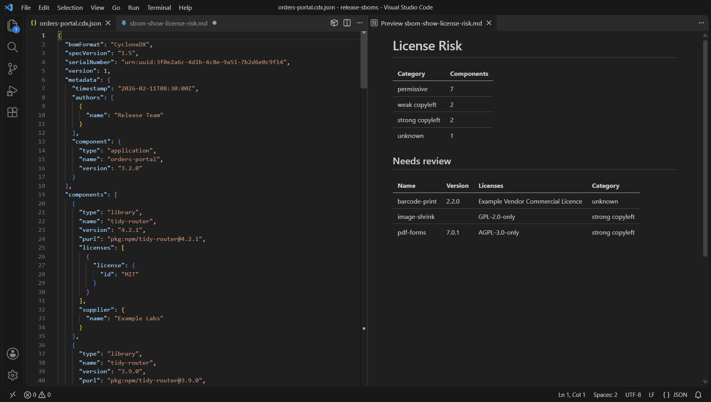
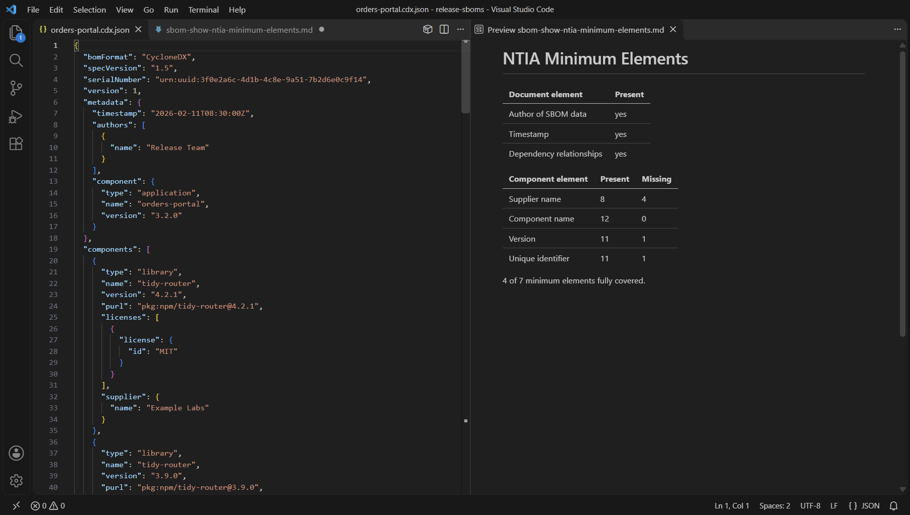

# SBOM Atlas

SBOM Atlas reads software bills of materials in the JSON formats of CycloneDX and SPDX and turns them into clear Markdown reports: what the SBOM covers and which ecosystems it contains, every component with its version, licenses and package URL, components that appear in several versions, a license risk review (permissive, weak copyleft, strong copyleft, unknown) and a check of the NTIA minimum elements that customers and regulators ask for.

Everything runs on your computer. There is no telemetry. The only network request the extension ever makes is the licence check for the optional Pro tier (see [Privacy](PRIVACY.md)).

## What it does

* **Show Summary**: The SBOM at a glance: format and version, the product it describes, how many components carry a version, a license and a package URL, and which ecosystems they come from.
* **Show Components**: Every component with its version, type, licenses and package URL, sorted by name.
* **Show Duplicate Components**: Components that appear in more than one version, a common source of bloat and of missed security updates.
* **Show License Risk** (Pro): Components sorted into permissive, weak copyleft, strong copyleft and unknown licenses, with the ones to review.
* **Show NTIA Minimum Elements** (Pro): Checks the NTIA minimum elements: author, timestamp, dependency relationships, and supplier, name, version and unique identifier per component.

## Free, trial and Pro

| Feature | Free | Pro |
| --- | :---: | :---: |
| Show Summary | yes | yes |
| Show Components | yes | yes |
| Show Duplicate Components | yes | yes |
| Show License Risk |  | yes |
| Show NTIA Minimum Elements |  | yes |
| Open Sample File, walkthrough, Report A Problem | yes | yes |

The free reports need no key, no account and no network connection, and they will not be moved behind the licence key later. The first Pro command starts a **free 14-day trial** on this computer. After that, Pro is a one-time purchase, not a subscription: **Pro Personal USD 19** (one person, use at work allowed) or **Pro Business USD 39 per user** (one key per user of an organisation). A key works on up to 3 computers. The checkout page shows the final price and any taxes for your country. Licence keys are sold by Dodo Payments, the merchant of record. Details: [licence](docs/licence.md), [terms](TERMS.md).

## Commands

Open the Command Palette and type `SBOM Atlas`.

| Command | Tier |
| --- | :---: |
| SBOM Atlas: Show Summary | Free |
| SBOM Atlas: Show Components | Free |
| SBOM Atlas: Show Duplicate Components | Free |
| SBOM Atlas: Show License Risk | Pro |
| SBOM Atlas: Show NTIA Minimum Elements | Pro |
| SBOM Atlas: Open Sample File | Free |
| SBOM Atlas: Open Sample SPDX File | Free |
| SBOM Atlas: Open Walkthrough | Free |
| SBOM Atlas: Show Documentation | Free |
| SBOM Atlas: Report A Problem | Free |
| SBOM Atlas: Buy Pro | Free |
| SBOM Atlas: Enter Licence Key | Free |
| SBOM Atlas: Show Licence Status | Free |
| SBOM Atlas: Remove Licence From This Machine | Free |

## Settings

| Setting | Default | Meaning |
| --- | --- | --- |
| `sbomAtlas.maxFileSizeMB` | 50 | Largest file a report reads (0.1 to 50 MB; VS Code passes files only up to 50 MB to extensions). |
| `sbomAtlas.openReportsAsPreview` | true | Open each report in the Markdown preview as well. |

## FAQ

**Does SBOM Atlas upload my SBOM?**
No. Every report is created on your computer from the text in the editor, and nothing is sent anywhere.

**Which formats are supported?**
CycloneDX JSON (any specVersion, nested components included) and SPDX JSON 2.2 and 2.3. XML and SPDX tag-value files are recognised and reported as not supported.

**How are license expressions such as MIT OR GPL-2.0-only rated?**
With OR the least restrictive choice counts, with AND the most restrictive part; AND binds tighter than OR, parentheses are respected and 'X WITH exception' counts as X. Identifiers that are not on the built-in lists, and expressions that are malformed, are rated unknown, so they show up for review instead of being guessed.

**Is the license review legal advice?**
No. It sorts the license identifiers written in the SBOM into categories so that you know where to look; the licenses themselves and your counsel decide what applies.

## For IT and procurement

* Publisher: SmallStepsStudio (Visual Studio Marketplace), smallstepsstudio (Open VSX).
* Network: one host, `live.dodopayments.com`, for the licence check only, and only after a key is entered. No telemetry. The trial uses no network.
* Files are read from the editor only; the extension writes no files and changes none.
* Source: <https://github.com/small-steps-studio/sbom-atlas>.
* Licence agreement: [LICENSE.txt](LICENSE.txt). Terms: [TERMS.md](TERMS.md). Privacy: [PRIVACY.md](PRIVACY.md).

## Support

Run **SBOM Atlas: Report A Problem** or open an issue at <https://github.com/small-steps-studio/sbom-atlas/issues>. Never post a licence key or confidential data in a public issue.

CycloneDX is an OWASP standard and SPDX is a trademark of the Linux Foundation; SBOM Atlas is an independent product and is not affiliated with or endorsed by OWASP or the Linux Foundation.
